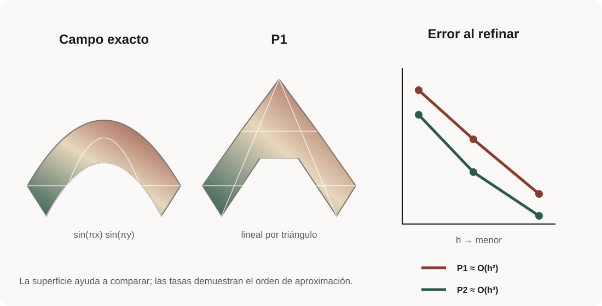
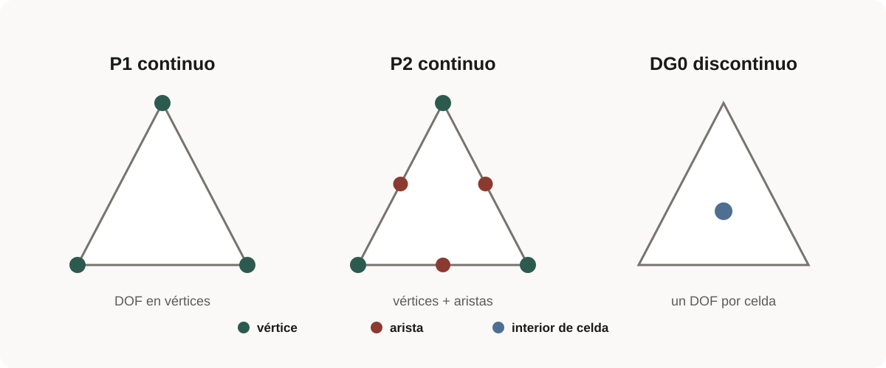
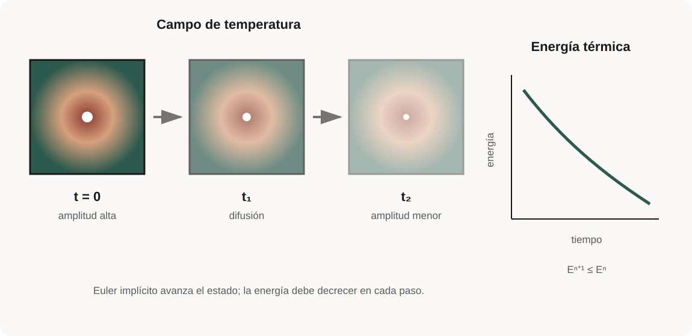
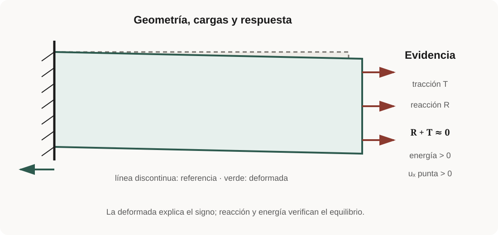
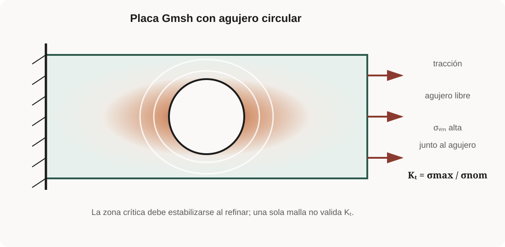
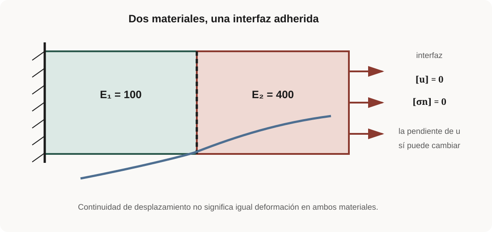
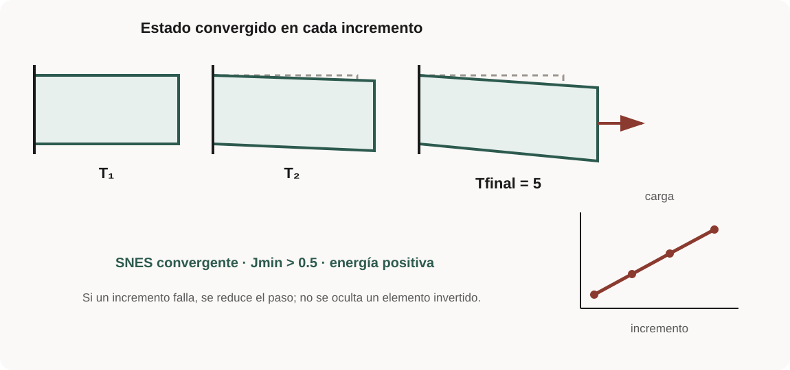
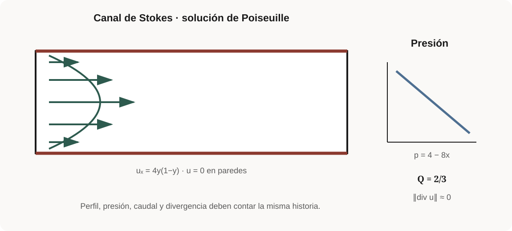
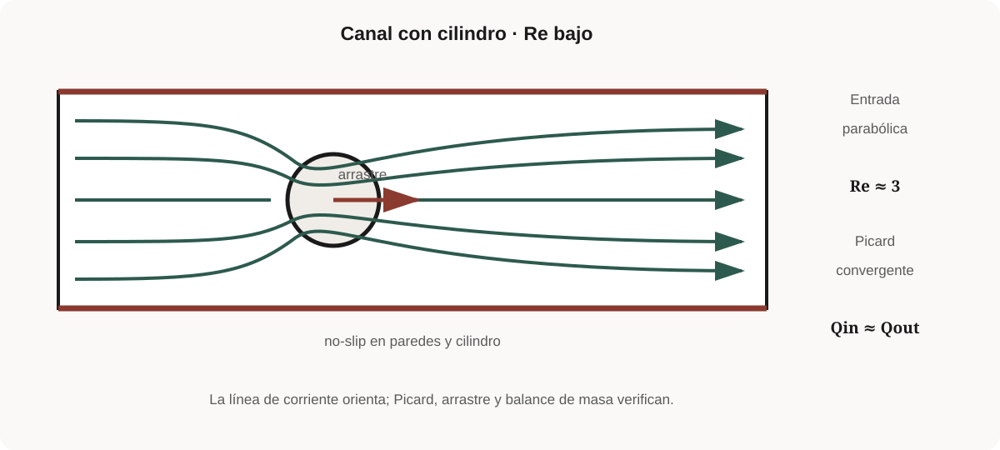
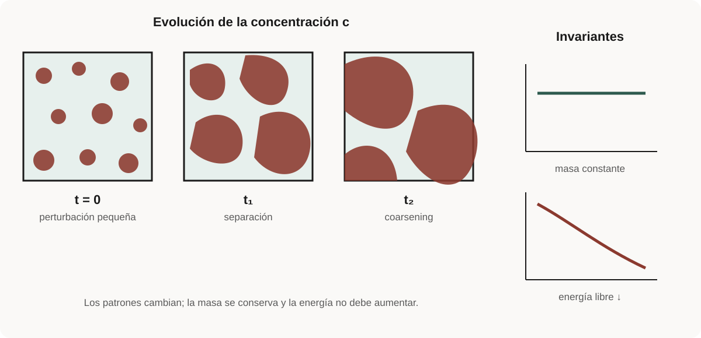

# Repertorio verificable de ejemplos

Este repertorio te ayuda a encontrar una implementación después de estudiar su
lección. No es una ruta paralela ni una página para leer de arriba abajo.

Cada script es la única fuente ejecutable, acepta `--output DIR`, produce un
resumen JSON y declara un criterio cuantitativo. Usa `--quick` para una ejecución
breve y `--write-fields` cuando el ejemplo permita exportar campos.

## Galería visual de los trece casos

Cada figura responde tres preguntas antes de ejecutar: **¿cuál es la
geometría?**, **¿qué fenómeno debo observar?** y **¿qué métrica lo confirma?**
El dibujo prepara una predicción; el JSON decide si el caso pasa.

<div class="grid cards example-gallery" markdown>

- **00 · Entorno y MPI**

    

    La partición cambia, pero deben conservarse ocho celdas globales.

    [Lección](../modules/00-orientation/index.md){ .md-button }
    [Código](https://github.com/MC-Andes/fenicsx-course/blob/main/examples/00_sanity_check.py){ .md-button }

- **01 · Poisson manufacturado**

    

    Frontera nula, máximo central y tasas L2/H1 cercanas a 2/1.

    [Lección](../modules/04-poisson/index.md){ .md-button }
    [Código](https://github.com/MC-Andes/fenicsx-course/blob/main/examples/01_poisson_manufactured.py){ .md-button }

- **02 · Interpolación P1/P2**

    

    El mismo campo se aproxima con tasas distintas al refinar.

    [Lección](../modules/01-variables/index.md){ .md-button }
    [Código](https://github.com/MC-Andes/fenicsx-course/blob/main/examples/02_interpolation.py){ .md-button }

- **03 · Fronteras etiquetadas**

    

    Las etiquetas deben recuperar longitudes 1, 1, 2 y 2.

    [Lección](../modules/02-meshes/index.md){ .md-button }
    [Código](https://github.com/MC-Andes/fenicsx-course/blob/main/examples/03_tagged_boundaries.py){ .md-button }

- **04 · Espacios de funciones**

    

    Vértices, aristas y celdas almacenan información diferente.

    [Lección](../modules/03-spaces/index.md){ .md-button }
    [Código](https://github.com/MC-Andes/fenicsx-course/blob/main/examples/04_function_spaces.py){ .md-button }

- **05 · Difusión transitoria**

    

    La amplitud disminuye y la energía no debe aumentar.

    [Lección](../modules/05-diffusion/index.md){ .md-button }
    [Código](https://github.com/MC-Andes/fenicsx-course/blob/main/examples/05_heat_diffusion.py){ .md-button }

- **06 · Elasticidad lineal**

    

    Deformada, reacción y carga deben respetar el equilibrio.

    [Lección](../modules/06-elasticity/index.md){ .md-button }
    [Código](https://github.com/MC-Andes/fenicsx-course/blob/main/examples/06_linear_elasticity.py){ .md-button }

- **07 · Placa con agujero**

    

    La concentración localizada debe estudiarse al refinar la malla.

    [Lección](../modules/07-gmsh/index.md#caso-07-placa-con-agujero){ .md-button }
    [Código](https://github.com/MC-Andes/fenicsx-course/blob/main/examples/07_plate_with_hole.py){ .md-button }

- **08 · Placa de dos materiales**

    

    El desplazamiento es continuo y la tracción se equilibra en la interfaz.

    [Lección](../modules/07-gmsh/index.md#caso-08-placa-de-dos-materiales){ .md-button }
    [Código](https://github.com/MC-Andes/fenicsx-course/blob/main/examples/08_two_materials.py){ .md-button }

- **09 · Hiperelasticidad**

    

    Cada incremento debe converger sin invertir elementos.

    [Lección](../modules/09-nonlinear/index.md){ .md-button }
    [Código](https://github.com/MC-Andes/fenicsx-course/blob/main/examples/09_hyperelasticity.py){ .md-button }

- **10 · Canal de Stokes**

    

    Perfil, presión, caudal y divergencia ofrecen referencias analíticas.

    [Lección](../modules/08-stokes/index.md){ .md-button }
    [Código](https://github.com/MC-Andes/fenicsx-course/blob/main/examples/10_stokes_channel.py){ .md-button }

- **11 · Flujo alrededor de cilindro**

    

    Picard, arrastre y balance de caudal verifican el caso.

    [Lección](../modules/navier-stokes/index.md){ .md-button }
    [Código](https://github.com/MC-Andes/fenicsx-course/blob/main/examples/11_cylinder_flow.py){ .md-button }

- **12 · Cahn–Hilliard**

    

    El patrón cambia mientras la masa se conserva y la energía libre disminuye.

    [Lección](../modules/10-multiphysics/index.md){ .md-button }
    [Código](https://github.com/MC-Andes/fenicsx-course/blob/main/examples/12_cahn_hilliard.py){ .md-button }

</div>

## Núcleo común

| # | Ejemplo | Estudia primero | Evidencia | Código |
| ---: | --- | --- | --- | --- |
| 00 | sanity check | [orientación](../modules/00-orientation/index.md) | versiones y celdas globales | [`.py`](https://github.com/MC-Andes/fenicsx-course/blob/main/examples/00_sanity_check.py) |
| 01 | Poisson manufacturado | [primer problema](../modules/04-poisson/index.md) | tasas L2/H1 | [`.py`](https://github.com/MC-Andes/fenicsx-course/blob/main/examples/01_poisson_manufactured.py) |
| 02 | interpolación P1/P2 | [objetos DOLFINx](../modules/01-variables/index.md) | tasas de interpolación | [`.py`](https://github.com/MC-Andes/fenicsx-course/blob/main/examples/02_interpolation.py) |
| 03 | fronteras etiquetadas | [mallas y fronteras](../modules/02-meshes/index.md) | medidas del contorno | [`.py`](https://github.com/MC-Andes/fenicsx-course/blob/main/examples/03_tagged_boundaries.py) |
| 04 | espacios de funciones | [elementos y espacios](../modules/03-spaces/index.md) | DOF globales | [`.py`](https://github.com/MC-Andes/fenicsx-course/blob/main/examples/04_function_spaces.py) |

## Transferencia de calor

| # | Ejemplo | Estudia primero | Evidencia | Código |
| ---: | --- | --- | --- | --- |
| 05 | difusión transitoria | [lección 6](../modules/05-diffusion/index.md) | error analítico y energía | [`.py`](https://github.com/MC-Andes/fenicsx-course/blob/main/examples/05_heat_diffusion.py) |

## Mecánica de sólidos

| # | Ejemplo | Estudia primero | Evidencia | Código |
| ---: | --- | --- | --- | --- |
| 06 | elasticidad lineal | [lección 7](../modules/06-elasticity/index.md) | reacción y energía | [`.py`](https://github.com/MC-Andes/fenicsx-course/blob/main/examples/06_linear_elasticity.py) |
| 07 | placa con agujero | [lección 8](../modules/07-gmsh/index.md) | concentración y malla | [`.py`](https://github.com/MC-Andes/fenicsx-course/blob/main/examples/07_plate_with_hole.py) |
| 08 | placa de dos materiales | [lección 8](../modules/07-gmsh/index.md) | continuidad y balance | [`.py`](https://github.com/MC-Andes/fenicsx-course/blob/main/examples/08_two_materials.py) |
| 09 | hiperelasticidad | [lección 9](../modules/09-nonlinear/index.md) | SNES, energía y $J$ | [`.py`](https://github.com/MC-Andes/fenicsx-course/blob/main/examples/09_hyperelasticity.py) |

## Mecánica de fluidos

| # | Ejemplo | Estudia primero | Evidencia | Código |
| ---: | --- | --- | --- | --- |
| 10 | canal de Stokes | [lección 10](../modules/08-stokes/index.md) | Poiseuille, caudal y divergencia | [`.py`](https://github.com/MC-Andes/fenicsx-course/blob/main/examples/10_stokes_channel.py) |
| 11 | flujo alrededor de cilindro | [lección 11](../modules/navier-stokes/index.md) | Picard, arrastre y masa | [`.py`](https://github.com/MC-Andes/fenicsx-course/blob/main/examples/11_cylinder_flow.py) |

## Multifísica

| # | Ejemplo | Estudia primero | Evidencia | Código |
| ---: | --- | --- | --- | --- |
| 12 | Cahn–Hilliard | [lección 12](../modules/10-multiphysics/index.md) | masa y energía libre | [`.py`](https://github.com/MC-Andes/fenicsx-course/blob/main/examples/12_cahn_hilliard.py) |

## Ejecución

```bash
python examples/01_poisson_manufactured.py --quick --output results
python -m mcandes_fenicsx.validation_cli .
```

Los JSON incluyen `example`, `dolfinx_version`, `mpi_size`,
`solver_converged` y `validation_passed`. Las pruebas comparan escalares,
normas y tendencias; nunca archivos binarios bit a bit.

## Cómo leer un script

Busca siempre los mismos ocho bloques:

1. parámetros y comunicador;
2. malla y etiquetas;
3. elemento y espacio;
4. datos, ensayo y prueba;
5. forma débil;
6. condiciones y solver;
7. verificación;
8. salida JSON o campos.

No todos los archivos usan encabezados idénticos, pero deben conservar esa
responsabilidad. El objetivo es reconocer el patrón y encontrar qué cambia con
la física.

## Regla para ampliar el repertorio

Un problema nuevo aparece aquí únicamente cuando entrega, en el mismo cambio:

1. ecuación, dominio, condiciones, parámetros y unidades;
2. script completo y metadata en `examples/metadata/`;
3. criterio cuantitativo con tolerancia explícita;
4. resultado reproducible y al menos una prueba automatizada;
5. lección o sección que explique por qué el ejemplo ocupa ese lugar;
6. fuente técnica y soporte serial/MPI declarado.

---

**Empieza por:** [mapa del curso](../learning-path.md) ·
**Practica con:** [ejercicios y soluciones](../practice/exercises.md)
