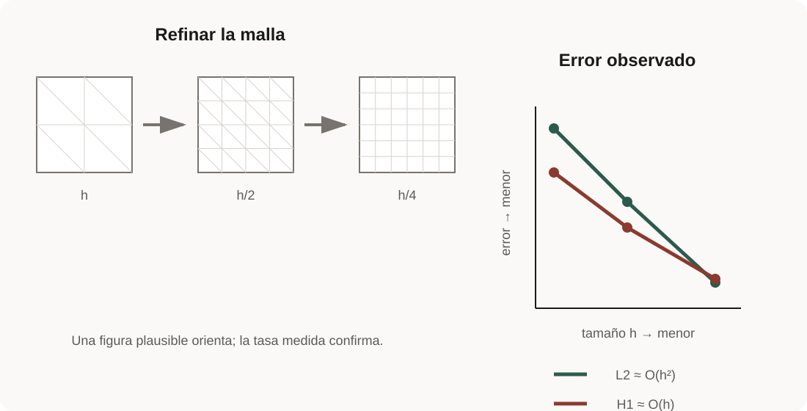
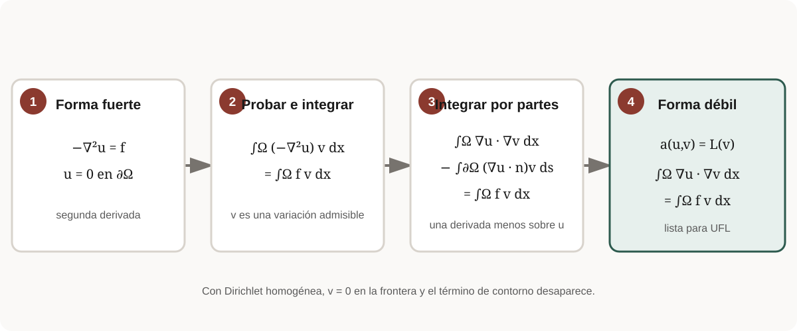
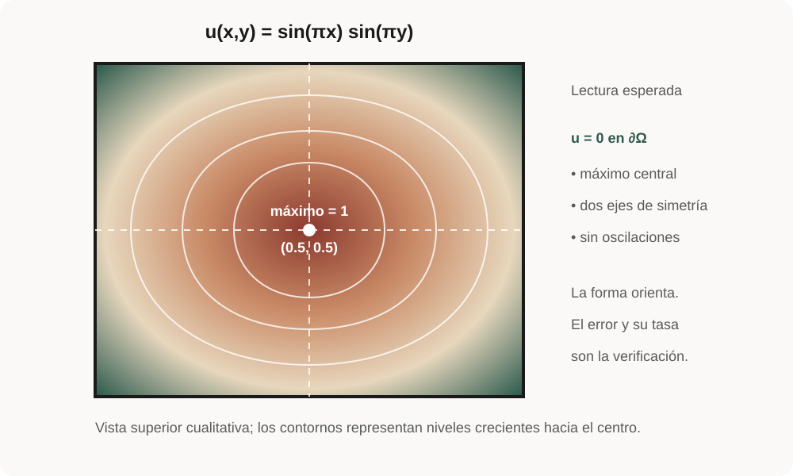

# Laboratorio guiado · Tu primera simulación paso a paso

**Nivel:** inicial · **Tiempo:** 2–3 h · **Prerrequisitos:** lecciones 0–1.

Este laboratorio acompaña, línea por línea, el ejemplo de Poisson del curso.
No crearás un cuaderno ni copiarás fragmentos aislados: ejecutarás el script
canónico y aprenderás a reconocer en él las ocho decisiones que aparecen en
casi cualquier programa de FEniCSx.

Al terminar podrás explicar el recorrido completo:

> problema físico → forma débil → malla → espacio → condiciones → sistema
> algebraico → solución → verificación.

!!! info "Cómo usar esta página"
    Avanza un paso a la vez. En cada **punto de control**, intenta responder sin
    mirar la solución. Si una respuesta no es clara, usa el enlace de repaso;
    no sigas acumulando términos desconocidos.

## El resultado que vas a construir

Resolveremos

\[
-\nabla^2u=f\quad\text{en }\Omega=(0,1)^2,
\qquad u=0\quad\text{en }\partial\Omega,
\]

con la solución manufacturada

\[
u_{\mathrm{exacta}}(x,y)=\sin(\pi x)\sin(\pi y),
\qquad f=2\pi^2u_{\mathrm{exacta}}.
\]

“Manufacturada” significa que primero elegimos una solución conocida y después
calculamos la fuente que la hace cumplir la PDE. Esto permite comparar la
aproximación numérica contra una referencia exacta.

{ .lesson-figure loading=lazy }

<p class="figure-caption">Al refinar, la imagen debe mejorar y los errores deben decrecer con el orden esperado. La segunda evidencia es la decisiva.</p>

## Antes de empezar: confirma el entorno

Desde la raíz del repositorio activa el entorno descrito en
[Instalación](../setup.md) y ejecuta:

```bash
python examples/00_sanity_check.py --output results
```

Debes ver un JSON con estas tres señales:

```json
{
  "dolfinx_version": "0.11.0",
  "mesh_cells_global": 8,
  "validation_passed": true
}
```

El resultado real contiene más campos. No continúes si el comando usa otra
versión de Python o no encuentra `dolfinx`: resuelve primero el
[diagnóstico del entorno](../troubleshooting.md).

## El archivo que estudiarás

Abre `examples/01_poisson_manufactured.py`, pero no intentes leerlo entero de
una vez. La función `solve_poisson(n)` contiene un solve para una malla; `main()`
repite el solve con varios refinamientos y calcula las tasas.

Ejecuta primero el caso corto:

```bash
python examples/01_poisson_manufactured.py --quick --output results
```

Esto crea `results/poisson-manufactured.json`. Mantén ese archivo abierto: será
tu tablero de comprobación durante el laboratorio.

## Paso 1 · Construir el dominio discreto

Localiza esta línea:

```python
domain = mesh.create_unit_square(
    MPI.COMM_WORLD, n, n, mesh.CellType.triangle
)
```

Aquí se decide:

- **geometría:** un cuadrado de lado 1;
- **resolución:** `n` subdivisiones por dirección;
- **tipo de celda:** triángulos;
- **comunicador:** todos los procesos de `MPI.COMM_WORLD` participan.

La malla no es la solución. Es la representación discreta del lugar donde vive
la PDE. Para `n=8` hay $8\times8$ cuadrados lógicos, cada uno dividido en dos
triángulos: 128 celdas globales.

!!! question "Punto de control 1"
    Si duplicas `n`, ¿se duplican o se cuadruplican aproximadamente las celdas
    en 2D? **Respuesta:** se cuadruplican, porque refinas ambas direcciones.

[Repaso visual de mallas y dimensiones](../modules/02-meshes/index.md).

## Paso 2 · Elegir el espacio de aproximación

```python
space = fem.functionspace(domain, ("Lagrange", 1))
```

Esta línea crea un espacio escalar Lagrange de grado 1, también llamado P1:

- la solución es lineal dentro de cada triángulo;
- los grados de libertad están asociados a los vértices;
- la función es continua entre celdas;
- su gradiente es constante por celda y puede saltar entre celdas.

No confundas **malla** con **espacio**. La malla aporta celdas y conectividad;
el elemento aporta la regla local de aproximación; el espacio combina ambos y
numera los grados de libertad.

!!! question "Punto de control 2"
    ¿Cambiar `("Lagrange", 1)` por `("Lagrange", 2)` refina la geometría?
    **No.** Conserva la malla y aumenta el grado de la aproximación.

[Repaso visual de P1, P2 y DG0](../modules/03-spaces/index.md).

## Paso 3 · Declarar incógnita, prueba y datos

```python
u, v = ufl.TrialFunction(space), ufl.TestFunction(space)
x = ufl.SpatialCoordinate(domain)
exact = ufl.sin(ufl.pi * x[0]) * ufl.sin(ufl.pi * x[1])
source = 2.0 * ufl.pi**2 * exact
```

Lee las cuatro líneas por su papel:

| Nombre | Papel | ¿guarda coeficientes numéricos? |
| --- | --- | --- |
| `u` | incógnita simbólica de la forma lineal | no |
| `v` | variación o función de prueba | no |
| `x` | coordenada espacial simbólica | no |
| `exact`, `source` | expresiones UFL | no |

En este punto todavía no existe un vector solución. UFL está construyendo un
árbol simbólico que luego se compilará y ensamblará.

!!! question "Punto de control 3"
    ¿Por qué `u` no se grafica? Porque `TrialFunction` describe la dependencia
    de una forma respecto a la incógnita; no contiene valores. El objeto que
    devuelve `problem.solve()` sí es una `fem.Function` con coeficientes.

[Repaso de objetos DOLFINx y UFL](../modules/01-variables/index.md).

## Paso 4 · Traducir la forma débil a UFL

La formulación que buscamos es

\[
a(u,v)=L(v),\qquad
a(u,v)=\int_\Omega \nabla u\cdot\nabla v\,dx,
\qquad
L(v)=\int_\Omega fv\,dx.
\]

En el ejemplo aparece dentro de `LinearProblem`:

```python
ufl.inner(ufl.grad(u), ufl.grad(v)) * ufl.dx
ufl.inner(source, v) * ufl.dx
```

La primera expresión es bilineal: depende de ensayo y prueba, y producirá la
matriz $A$. La segunda es lineal en la prueba, y producirá el vector $b$.

| Matemática | UFL | Pregunta de lectura |
| --- | --- | --- |
| $\nabla u$ | `grad(u)` | ¿qué derivada se usa? |
| $\nabla u\cdot\nabla v$ | `inner(grad(u), grad(v))` | ¿qué se contrae? |
| $\int_\Omega \cdot\,dx$ | `... * ufl.dx` | ¿dónde se integra? |

!!! warning "Error de signo frecuente"
    Para $-\nabla^2u=f$, la integración por partes produce el signo positivo
    delante de $\nabla u\cdot\nabla v$. Si cambias la PDE, vuelve a derivar la
    forma; no corrijas signos por ensayo y error.

{ .lesson-figure loading=lazy }

<p class="figure-caption">La integración por partes reduce el orden de derivación exigido a la aproximación.</p>

## Paso 5 · Identificar la frontera e imponer Dirichlet

Primero se localizan todas las facetas exteriores:

```python
boundary_facets = mesh.locate_entities_boundary(
    domain,
    domain.topology.dim - 1,
    lambda points: np.full(points.shape[1], True),
)
```

Después se traducen las facetas a grados de libertad del espacio y se fija el
valor cero:

```python
dofs = fem.locate_dofs_topological(
    space, domain.topology.dim - 1, boundary_facets
)
bc = fem.dirichletbc(PETSc.ScalarType(0.0), dofs, space)
```

La secuencia es deliberada:

1. identificar entidades geométricas;
2. encontrar los grados de libertad asociados;
3. construir la condición para el espacio correcto.

Una etiqueta o una lista de facetas **no impone** una condición por sí sola.

!!! question "Punto de control 5"
    ¿Por qué se usa `domain.topology.dim - 1`? En una malla 2D las celdas tienen
    dimensión topológica 2 y sus facetas de frontera son aristas de dimensión 1.

## Paso 6 · Construir y resolver el sistema

```python
problem = LinearProblem(
    ufl.inner(ufl.grad(u), ufl.grad(v)) * ufl.dx,
    ufl.inner(source, v) * ufl.dx,
    bcs=[bc],
    petsc_options_prefix=f"mcandes_poisson_{n}_",
    petsc_options=direct_solver_options(),
)
solution = problem.solve()
solution.name = "u_h"
solution.x.scatter_forward()
reason = require_solver_convergence(problem.solver, "Poisson KSP")
```

`LinearProblem` compila las formas, ensambla $A$ y $b$, aplica las condiciones
esenciales y configura PETSc. `solve()` crea la `fem.Function` que sí contiene
la aproximación $u_h$.

`scatter_forward()` sincroniza valores fantasma tras el solve. La razón de
PETSc debe ser positiva; terminar la llamada sin excepción no basta para asumir
que el sistema convergió.

!!! question "Punto de control 6"
    En el JSON, comprueba que todos los valores de `solver_reasons` sean
    positivos y que `solver_converged` sea `true`.

## Paso 7 · Medir error y tasa de convergencia

Un solve que converge algebraicamente todavía puede representar una PDE mal
formulada. Por eso `solve_poisson` devuelve dos errores independientes:

```python
global_l2_error(solution, exact)
global_h1_seminorm_error(solution, exact)
```

`main()` repite el problema para `n = 8, 16` en modo rápido y calcula

\[
p=\frac{\log(e_2/e_1)}{\log(h_2/h_1)}.
\]

Para una solución suave y elementos P1 se esperan aproximadamente:

- error $L^2$: $O(h^2)$, tasa cercana a 2;
- seminorma $H^1$: $O(h)$, tasa cercana a 1.

Con los resultados de referencia del curso debes observar valores cercanos a
1.97 y 0.99. Los umbrales automáticos son 1.8 y 0.9.

!!! question "Punto de control 7"
    Abre `results/poisson-manufactured.json`. Explica por qué
    `validation_passed=true` aporta información distinta de
    `solver_converged=true`: el primero valida la discretización mediante tasas;
    el segundo solo confirma la solución del sistema algebraico.

## Paso 8 · Guardar evidencia antes de visualizar

El resumen JSON conserva versión, tamaño MPI, refinamientos, errores, tasas y
razones del solver. Solo después de validarlo genera campos para ParaView:

{ .lesson-figure loading=lazy }

<p class="figure-caption">Antes de abrir ParaView, predice frontera, máximo y simetrías. La visualización sirve para comparar esa predicción.</p>

```bash
python examples/01_poisson_manufactured.py \
  --quick \
  --write-fields \
  --output results
```

Esto crea `results/poisson/solution.xdmf` y sus datos asociados. Abre el XDMF
en ParaView, aplica **Warp By Scalar** si deseas ver la superficie y comprueba:

- valor cero en las cuatro aristas;
- máximo cerca del centro;
- simetría respecto a $x=0.5$ e $y=0.5$;
- ausencia de oscilaciones espurias.

La figura es una comprobación cualitativa. El JSON es la comprobación
cuantitativa y reproducible.

## Lectura completa del pipeline

Ahora vuelve a `solve_poisson(n)` y marca cada bloque:

| Paso | Objeto producido | Pregunta que debes poder responder |
| ---: | --- | --- |
| 1 | `domain` | ¿dónde se resuelve? |
| 2 | `space` | ¿cómo se aproxima la incógnita? |
| 3 | `u`, `v`, `source` | ¿qué es desconocido y qué es dato? |
| 4 | formas UFL | ¿qué identidad integral se impone? |
| 5 | `bc` | ¿qué grados de libertad están fijados? |
| 6 | `problem`, `solution` | ¿qué sistema se resolvió y convergió? |
| 7 | errores y tasas | ¿la aproximación mejora como debería? |
| 8 | JSON/XDMF | ¿qué evidencia puede reproducir otra persona? |

Si no puedes explicar una fila, vuelve únicamente a ese paso. Esa es la ventaja
de la estructura: el diagnóstico queda localizado.

## Tres modificaciones controladas

Haz una modificación por vez y regresa al caso base antes de continuar.

### A · Cambiar la resolución

Ejecuta sin `--quick`; se añade `n=32`. Predice primero el factor de reducción
del error. Para P1, al dividir $h$ por 2, el error L2 debería reducirse cerca de
4 y el H1 cerca de 2.

### B · Cambiar el grado

Copia el ejemplo a tu área de trabajo personal y cambia el grado 1 por 2. No
sobrescribas el ejemplo canónico. Actualiza también los umbrales esperados:
para una solución suave, P2 debe aproximarse a orden 3 en L2 y 2 en H1.

### C · Romper una condición de manera intencional

En una copia, elimina `bcs=[bc]` y observa el fallo o la singularidad. El
laplaciano con Neumann homogénea en toda la frontera tiene un nullspace
constante. Esta prueba conecta una decisión física con el comportamiento del
solver.

## Diagnóstico rápido

| Síntoma | Primera pregunta | Acción mínima |
| --- | --- | --- |
| `ModuleNotFoundError: dolfinx` | ¿activaste el entorno? | repite la instalación y sanity check |
| razón PETSc negativa | ¿la matriz es singular o el solver no converge? | conserva la razón y revisa las BC |
| tasa L2 cercana a 1 | ¿la fuente o la forma tienen un error? | compara PDE, exacta y signo |
| funciona en serial, falla con MPI | ¿usaste reducciones globales? | evita normas sobre arreglos locales |
| imagen plausible, validación falsa | ¿qué cantidad independiente falla? | confía primero en error/tasa |

## Lista de salida

Antes de pasar a la lección 3, confirma:

- [ ] puedo ejecutar el caso `--quick` sin copiar comandos desconocidos;
- [ ] distingo malla, elemento y espacio;
- [ ] distingo `TrialFunction` de `Function`;
- [ ] puedo leer `a(u,v)` y `L(v)` en UFL;
- [ ] sé cómo una faceta se convierte en DOF y luego en BC;
- [ ] compruebo la razón PETSc;
- [ ] interpreto tasas L2/H1;
- [ ] visualizo después de validar.

Si todas las casillas están claras, continúa con
[Objetos de DOLFINx y expresiones UFL](../modules/01-variables/index.md).

## Fuentes técnicas

- [Demo oficial de Poisson en DOLFINx 0.11](https://docs.fenicsproject.org/dolfinx/v0.11.0.post0/python/demos/demo_poisson.html).
- [API de mallas DOLFINx 0.11](https://docs.fenicsproject.org/dolfinx/v0.11.0.post0/python/generated/dolfinx.mesh.html).
- [Lenguaje de formas UFL 2026.1](https://docs.fenicsproject.org/ufl/2026.1.0/manual/form_language.html).
- [Solvers KSP de PETSc](https://petsc.org/release/manual/ksp/).

El recorrido, las figuras y los puntos de control son material original de
MC-Andes; el código ejecutado es `examples/01_poisson_manufactured.py`.

---

**Anterior:** [matemática mínima y forma débil](../foundations/weak-forms.md) ·
**Siguiente:** [lección 2 · Poisson](../modules/04-poisson/index.md)
