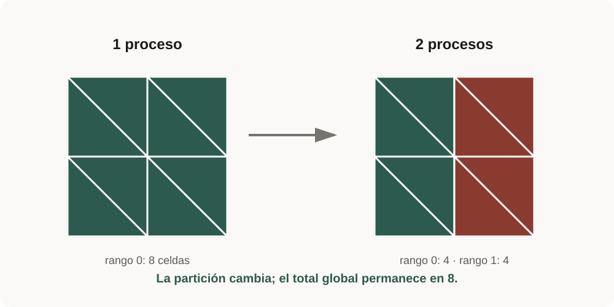
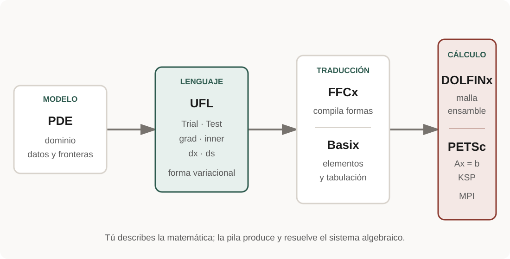

# Lección 0 · Orientación y entorno

**Nivel:** inicial · **Tiempo:** 60 min · **Prerrequisitos:** terminal, Git y Python básico.

## Tu punto de partida

Esta lección comprueba el entorno antes de introducir matemática o APIs. No
necesitas entender todavía cómo se resuelve una PDE: solo debes demostrar que
Python, DOLFINx y MPI pertenecen al mismo entorno y producen una medida global.

## Objetivos

Al terminar podrás distinguir FEniCSx de FEniCS legado, explicar el recorrido
UFL → FFCx/Basix → DOLFINx → PETSc/MPI y producir un reporte reproducible.

## Modelo, unidades y forma fuerte

No se resuelve una PDE. El “modelo” es una malla triangular del cuadrado unidad;
las coordenadas y resultados son adimensionales. La condición comprobable es
que una partición serial o MPI conserve ocho celdas globales.

{ .lesson-figure loading=lazy }

Cada rango almacena una parte distinta; la reducción global debe recuperar las mismas ocho celdas.

## Forma débil

No aplica todavía. Una forma débil aparecerá en la lección 1; aquí se comprueba
que los componentes capaces de compilarla y ensamblarla son compatibles.

## Mapa concepto → software

| Concepto | Objeto |
| --- | --- |
| lenguaje simbólico | UFL |
| elemento/tabulación | Basix |
| compilación de forma | FFCx |
| malla y espacio | DOLFINx |
| álgebra lineal | PETSc/petsc4py |
| memoria distribuida | MPI/mpi4py |

{ .lesson-figure loading=lazy }

UFL conserva la cercanía con la notación matemática; DOLFINx organiza la discretización y PETSc resuelve el sistema.

### Cómo leer la pila sin memorizar nombres

1. Tú eliges la PDE, el dominio, las condiciones y la forma débil.
2. UFL representa las integrales de manera simbólica.
3. FFCx y Basix convierten formas y elementos en kernels numéricos.
4. DOLFINx conecta malla, espacios, ensamblaje y datos distribuidos.
5. PETSc resuelve el sistema; MPI reparte el trabajo y comunica procesos.

En las primeras lecciones basta con reconocer quién hace cada tarea. No es
necesario llamar directamente a FFCx ni implementar comunicación MPI manual.

## Ejemplo mínimo e inspección

Ejecuta `python examples/00_sanity_check.py --output results`. El script
canónico es `examples/00_sanity_check.py`; imprime versiones, rango/tamaño MPI
y número global de celdas. Repite con `mpirun -n 2` y confirma que solo el rango
0 escribe el JSON.

!!! question "Punto de control"
    Si el resultado global cambia al pasar de uno a dos procesos, ¿falló la
    física? Todavía no hay física. Primero revisa el conteo de celdas propias,
    la reducción MPI y que los procesos usen el mismo entorno.

## Solver

No hay solver. Las banderas `solver_converged=true` significan “no requerido”,
no una solución de sistema ficticia.

## Verificación cuantitativa

La malla 2×2 se divide en dos triángulos por cuadrado: el total global debe ser
8, independientemente de la partición.

## Visualización e interpretación

La figura permite anticipar la partición, pero no reemplaza el conteo global.
En MPI, los colores o índices locales pueden cambiar sin alterar la malla física.

## Errores frecuentes

- Ejecutar `python` fuera del entorno y no encontrar DOLFINx.
- Mezclar `mpirun` del sistema con `mpi4py` del entorno.
- Imprimir/escribir desde todos los rangos y corromper una salida.

## Ejercicios graduados

1. Identifica la versión de cada componente y su responsabilidad.
2. Cambia la malla a 3×2 y predice el total antes de ejecutar.
3. Ejecuta con dos rangos y explica por qué cada proceso no posee ocho celdas.

## Solución o guía

La respuesta 3×2 es 12 triángulos globales. Para la distribución consulta
`index_map.size_local`; nunca sumes fantasmas. Compara con la solución en
`exercises/solutions/01_objects.py` para la clasificación del ecosistema.

## Fuentes, licencia y versión

API DOLFINx 0.11.0.post0. Código MIT, texto CC BY 4.0. Consulta
[documentación oficial](https://docs.fenicsproject.org/dolfinx/v0.11.0.post0/python/).

---

**Anterior:** [instalación](../../setup.md) ·
**Siguiente:** [matemática mínima y forma débil](../../foundations/weak-forms.md)
