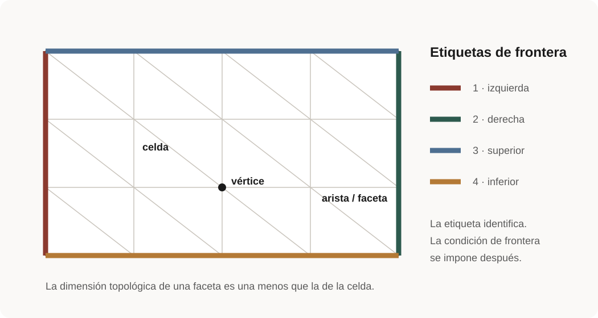

# Lección 4 · Mallas, etiquetas y condiciones de frontera

**Nivel:** inicial · **Tiempo:** 3 h · **Prerrequisitos:** lecciones 2–3, geometría básica.

## Conexión con Poisson

En el primer solve la frontera completa tenía Dirichlet homogénea. Aquí se
divide el contorno en regiones con significado y se comprueba cada etiqueta
antes de usarla en una condición. Esta práctica se reutiliza en calor, sólidos
y fluidos.

## Objetivos

Crearás intervalos, cuadrados, rectángulos y cajas; distinguirás dimensión
topológica/geométrica, localizarás entidades y construirás `MeshTags` sin
duplicar facetas.

## Modelo y unidades

El ejemplo usa un rectángulo 2×1 con cuatro fronteras. Las medidas tienen unidad
de longitud; la integral de 1 sobre cada frontera debe devolver 1, 1, 2 y 2.

## Forma fuerte y débil

No hay PDE. La identidad geométrica verificable es
$\int_{\Gamma_i}1\,ds=|\Gamma_i|$. Las normales exteriores se obtienen con
`FacetNormal`; `dS` quedará reservado para facetas interiores.

## Mapa concepto → software

| Concepto | Objeto |
| --- | --- |
| dominio discreto | `mesh.create_rectangle` |
| dimensión de celda | `domain.topology.dim` |
| dimensión espacial | `domain.geometry.dim` |
| frontera geométrica | `locate_entities_boundary` |
| marcador | `mesh.meshtags` |
| integral marcada | `ufl.Measure("ds", subdomain_data=tags)` |

{ .lesson-figure loading=lazy }

La malla describe conectividad; las etiquetas asignan significado a grupos de entidades, pero todavía no imponen una condición.

## Ejemplo e inspección

Ejecuta `python examples/03_tagged_boundaries.py --quick --output results`.
Examina `tags.indices`, `tags.values` y `tags.find(marker)`. La utilidad común
ordena índices y rechaza una faceta asignada dos veces.

### Secuencia segura para trabajar con fronteras

1. Define cada región geométrica con una función localizadora.
2. Localiza facetas usando `tdim - 1`, no la dimensión geométrica a ciegas.
3. Ordena índices y comprueba que una faceta no tenga dos etiquetas.
4. Construye `MeshTags` y examina sus valores únicos.
5. Integra 1 sobre cada `ds(tag)` y compara con la medida esperada.
6. Solo entonces usa la etiqueta en una carga, flujo o condición.

!!! question "Punto de control"
    Una esquina pertenece visualmente a dos lados, pero la entidad etiquetada
    aquí es la faceta completa. No dupliques facetas por clasificar vértices.

## Solver

No se resuelve un sistema. `assemble_scalar` entrega una contribución local; el
curso la suma con `MPI.Allreduce`.

## Verificación cuantitativa

El error absoluto máximo de las cuatro medidas debe ser <1e-12 tanto en serial
como con dos procesos.

## Visualización

Si exportas etiquetas, usa nombres/leyenda además del color. Comprueba primero
los valores únicos y las medidas.

## Errores frecuentes

- Usar dimensión geométrica para localizar facetas.
- Omitir la conectividad requerida antes de consultar adyacencias.
- Confundir `ds` (frontera exterior) con `dS` (interior).
- Clasificar esquinas como facetas y duplicar etiquetas.

## Ejercicios graduados

1. Cambia a un rectángulo 3×0.5 y predice medidas.
2. Construye triángulos y cuadriláteros con el mismo contorno.
3. Refina y demuestra que la longitud global no cambia.

## Solución o guía

La medida de frontera es independiente de la partición y refinamiento. Si
cambia, revisa marcadores y reducción antes de culpar la geometría.

## Fuentes, licencia y versión

[API de mallas DOLFINx 0.11](https://docs.fenicsproject.org/dolfinx/v0.11.0.post0/python/generated/dolfinx.mesh.html).
Código original MIT; contenido CC BY 4.0.

---

**Anterior:** [objetos de DOLFINx y UFL](../01-variables/index.md) ·
**Siguiente:** [elementos, espacios y convergencia](../03-spaces/index.md)
